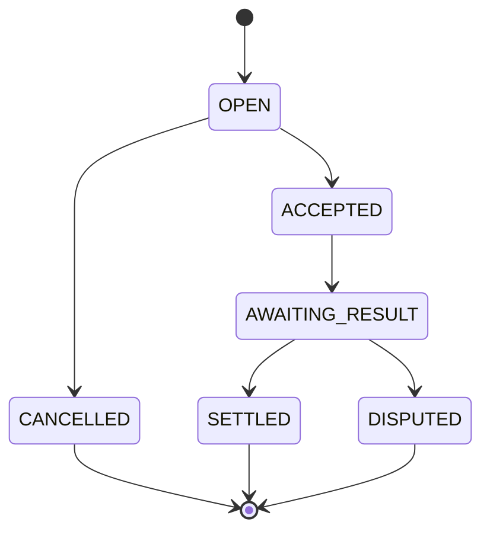
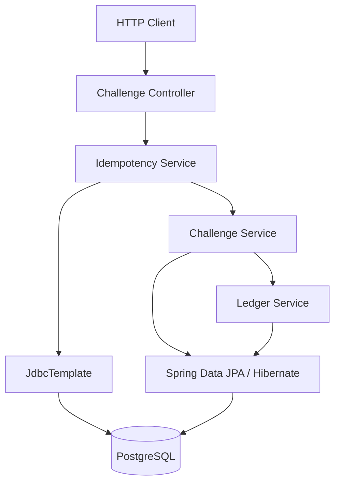

# PACTO

**Plataforma de desafios com créditos fictícios, desenvolvida para estudar idempotência, concorrência e integridade transacional.**

## Sobre o projeto

O PACTO é uma aplicação full stack em desenvolvimento, na qual dois participantes podem criar desafios, reservar créditos fictícios e confirmar resultados.

O principal objetivo é demonstrar conceitos de engenharia de software relacionados à confiabilidade de operações, incluindo:

- Idempotência persistente de requisições HTTP.
- Transações ACID e rollback.
- Controle de concorrência com PostgreSQL.
- Bloqueios pessimistas e restrições de unicidade.
- Ledger contábil imutável com lançamentos balanceados.
- Integridade de dados sob falhas e requisições simultâneas.
- Testes automatizados utilizando PostgreSQL real.

O sistema utiliza uma arquitetura monolítica modular, sem microserviços, priorizando simplicidade arquitetural, consistência e confiabilidade.

## Tecnologias

**Backend**

- Java 21
- Spring Boot 4
- Maven
- Spring Data JPA
- Hibernate
- Spring JdbcTemplate
- Jackson 3
- PostgreSQL 17
- Flyway

**Frontend**

- React
- TypeScript
- Vite

**Testes**

- JUnit 5
- Mockito
- MockMvc
- Testcontainers
- Java HttpClient

**Infraestrutura**

- Docker Compose
- Git
- GitHub

## Fluxo de negócio

1. Dois usuários de demonstração recebem 100 créditos fictícios cada.
2. Um participante cria um desafio com uma contribuição inteira positiva.
3. O destinatário aceita o desafio.
4. O sistema reserva atomicamente os créditos dos dois participantes.
5. Cada participante confirma quem venceu.
6. Se ambos concordarem, os créditos reservados são transferidos para o vencedor.
7. Se discordarem, os créditos permanecem bloqueados em custódia.

O criador também pode cancelar um desafio enquanto ele estiver aberto, antes do aceite.

Exemplo: Bruno e Lucas começam com 100 créditos cada. Ambos reservam 20 para um desafio. Se Bruno for confirmado como vencedor pelos dois, ele terminará com 120 créditos disponíveis e Lucas com 80.

### Estados de um desafio



## Arquitetura

O backend é um monólito modular Spring Boot organizado por responsabilidades de domínio:

- `user`: usuários e identidades de demonstração.
- `challenge`: ciclo de vida dos desafios, aceite, cancelamento, confirmações e disputas.
- `wallet`: carteiras, contas, saldos e custódia.
- `ledger`: transações contábeis, lançamentos, reservas e liquidações.
- `idempotency`: aquisição de chaves idempotentes, identificação de payloads e recuperação de respostas persistidas.

A persistência utiliza PostgreSQL, com esquema gerenciado por migrations Flyway.

O frontend utiliza React e TypeScript, com integração à API REST prevista nas próximas etapas do desenvolvimento.

### Visão arquitetural



## Ledger e integridade transacional

As movimentações contábeis são registradas em um ledger imutável, utilizando lançamentos balanceados e saldos materializados reconciliáveis.

O sistema possui mecanismos para preservar as seguintes invariantes:

- A soma dos lançamentos de cada transação contábil deve ser igual a zero.
- Os saldos materializados devem corresponder aos respectivos lançamentos.
- Contas sujeitas à restrição de saldo não podem apresentar valores negativos.
- Reservas e liquidações devem ocorrer atomicamente.
- Falhas durante operações financeiras devem provocar rollback.
- Desafios contestados devem manter os créditos em custódia.
- Retries de comandos bem-sucedidos não devem duplicar movimentações financeiras.

As operações críticas são executadas dentro de transações gerenciadas pelo Spring.

## Idempotência persistente

Todos os comandos de alteração de desafios são protegidos por chaves idempotentes persistidas no PostgreSQL.

### Endpoints protegidos

| Método | Endpoint                       | Status de sucesso |
| ------ | ------------------------------ | ----------------- |
| POST   | `/api/challenges`              | 201 Created       |
| POST   | `/api/challenges/{id}/accept`  | 200 OK            |
| POST   | `/api/challenges/{id}/confirm` | 200 OK            |
| POST   | `/api/challenges/{id}/cancel`  | 200 OK            |

Esses endpoints exigem os seguintes headers:

```http
X-Actor-Id: <user-uuid>
Idempotency-Key: <unique-command-key>
```

Cada chave é identificada pela combinação de:

- Identificador do usuário.
- Tipo de operação.
- Chave idempotente.

O sistema utiliza SHA-256 sobre uma representação canonicalizada dos parâmetros do comando para identificar payloads semanticamente equivalentes.

Por exemplo, contribuições representadas como `20` e `20.0` produzem o mesmo hash quando correspondem ao mesmo comando válido.

### Comportamento das requisições

| Cenário                              | Comportamento                    |
| ------------------------------------ | -------------------------------- |
| Nova chave válida                    | Executa a operação               |
| Chave persistida e mesmo payload     | Retorna a resposta original      |
| Chave persistida e payload diferente | HTTP 409 Conflict                |
| Chave ausente ou inválida            | HTTP 400 Bad Request             |
| Usuário inexistente                  | HTTP 403 Forbidden               |
| Timeout de bloqueio tratado          | HTTP 503 Service Unavailable     |
| Falha durante a transação            | Rollback dos efeitos da operação |

Na implementação atual, somente respostas bem-sucedidas são persistidas.

O replay preserva o status HTTP original, o conteúdo semântico da resposta JSON e, nas operações de criação, o header `Location`.

Uma resposta recuperada representa o resultado histórico do comando, não necessariamente o estado atual do recurso.

### Garantias transacionais

O registro idempotente e os efeitos da operação de negócio são persistidos dentro da mesma transação.

A implementação utiliza:

- Restrição de unicidade no PostgreSQL.
- `INSERT ON CONFLICT DO NOTHING`.
- `SELECT FOR UPDATE`.
- Isolamento `READ COMMITTED`.
- Persistência de respostas em `JSONB`.
- Timeout de bloqueio configurado por transação.
- Rollback compartilhado entre idempotência e operações financeiras.

Não são utilizados Redis, caches distribuídos ou mecanismos de sincronização em memória para coordenar a idempotência.

### Decisões de persistência

O projeto utiliza Spring Data JPA para persistência das entidades de domínio e `JdbcTemplate` para o módulo de idempotência.

Essa abordagem permite controlar explicitamente a execução de instruções SQL específicas do PostgreSQL, sem abrir mão do gerenciamento transacional do Spring.

Ambas as tecnologias compartilham o mesmo `DataSource` e participam da mesma transação.

O repository de idempotência utiliza `SQLErrorCodeSQLExceptionTranslator` para traduzir erros específicos do PostgreSQL.

Falhas de aquisição de bloqueio, como o SQLSTATE `55P03`, são tratadas como falhas transitórias, retornando HTTP 503 com o header `Retry-After`.

## Como executar localmente

### Pré-requisitos

- JDK 21
- Node.js e npm compatíveis com o Vite
- Docker com Docker Compose
- Git

### 1. Clonar o repositório

```bash
git clone https://github.com/ImSena/pacto.git
cd pacto
```

### 2. Configurar o banco de dados

Na raiz do projeto, crie o arquivo de configuração local:

```bash
cp .env.example .env.pacto
```

Defina uma senha local em `.env.pacto`. Esse arquivo não deve ser versionado.

Inicie o PostgreSQL:

```bash
docker compose --env-file .env.pacto up -d
```

### 3. Iniciar o backend

No terminal, a partir da raiz do repositório:

```bash
set -a
source .env.pacto
set +a

cd backend
./mvnw spring-boot:run
```

O backend estará disponível em:

http://localhost:8080

Para verificar sua saúde:

```bash
curl http://localhost:8080/actuator/health
```

Resposta esperada:

```json
{
  "status": "UP"
}
```

### 4. Iniciar o frontend

Em outro terminal:

```bash
cd frontend
npm install
npm run dev
```

Abra o endereço informado pelo Vite, normalmente:

http://localhost:5173

O frontend ainda está em desenvolvimento.

## Testes e validação

O PACTO utiliza diferentes níveis de testes automatizados para validar regras de negócio, contratos HTTP e garantias transacionais.

### Testes unitários

Validam individualmente:

- Regras de domínio.
- Transições de estado.
- Validação de parâmetros.
- Operações do ledger.
- Canonicalização e hashing de payloads.
- Validação de chaves idempotentes.
- Orquestração de comandos.

### Testes de controller

Utilizam MockMvc e Mockito para validar:

- Contratos HTTP.
- Headers obrigatórios.
- Códigos de resposta.
- Serialização JSON.
- Tratamento de exceções.
- Recuperação de respostas idempotentes.

### Testes de integração

Utilizam Testcontainers com PostgreSQL 17 real para validar:

- Persistência de dados e migrations.
- Reservas e liquidações financeiras.
- Rollback de operações.
- Falhas durante o commit.
- Compartilhamento transacional entre JPA e JDBC.
- Replay de respostas persistidas.
- Conflitos de payload.
- Requisições concorrentes com a mesma chave.
- Timeouts reais de bloqueio.
- Retries após rollback.
- Integridade do ledger e conservação de créditos.

Os testes financeiros também realizam verificações independentes diretamente no PostgreSQL.

### Executar todos os testes do backend

Com o Docker em execução:

```bash
cd backend
./mvnw clean verify
```

Os testes de integração que utilizam Testcontainers criam bancos de dados isolados, independentes do banco de desenvolvimento.

### Executar os testes de idempotência

```bash
cd backend

./mvnw \
-Dtest=IdempotencyKeyValidatorTest,PayloadHasherTest,IdempotencyServiceTest,IdempotencyRepositoryIntegrationTest,ChallengeIdempotencyControllerTest,ChallengeIdempotencyIntegrationTest \
test
```

### Validar o build do frontend

```bash
cd frontend
npm install
npm run build
```

## Roadmap

### Implementado

- [x] Estrutura inicial do projeto.
- [x] Ambiente PostgreSQL com Docker Compose.
- [x] Migrations com Flyway.
- [x] Usuários e créditos de demonstração.
- [x] Carteiras e contas contábeis.
- [x] Ledger imutável.
- [x] Validação de saldo e movimentações.
- [x] Criação de desafios.
- [x] Aceite e reserva atômica de créditos.
- [x] Confirmação de resultados.
- [x] Liquidação financeira.
- [x] Tratamento de disputas.
- [x] Cancelamento de desafios.
- [x] Idempotência persistente.
- [x] Canonicalização e hashing de payloads.
- [x] Replay de respostas HTTP.
- [x] Tratamento de timeouts de idempotência.
- [x] Testes de integração de idempotência com PostgreSQL real.

### Próximas etapas

- [ ] Bloqueio pessimista de desafios e contas.
- [ ] Ordenação determinística de bloqueios.
- [ ] Testes de concorrência intensiva.
- [ ] Ampliação dos testes de retry e integridade do ledger.
- [ ] Dashboard de saldos e extrato.
- [ ] Interface de criação e gerenciamento de desafios.
- [ ] Integração completa entre frontend e backend.
- [ ] Tratamento de falhas e retries no frontend.
- [ ] Pipeline de integração contínua.
- [ ] Demonstração reproduzível do sistema completo.

## Limitações

Este é um projeto educacional e de portfólio.

- Os créditos não possuem valor monetário.
- Não há depósitos, saques, pagamentos reais ou integração bancária.
- O MVP utiliza usuários fixos de demonstração, sem autenticação real.
- Resultados contestados permanecem com créditos em custódia, sem resolução administrativa nesta versão.
- Registros idempotentes ainda não possuem política de expiração.
- Respostas de erro não são persistidas como resultados idempotentes.
- O controle de concorrência entre operações com chaves diferentes ainda está em desenvolvimento.
- O frontend ainda está em desenvolvimento.

O sistema não deve ser utilizado como serviço financeiro de produção.

## Documentação técnica

- [Especificação do MVP](docs/mvp.md)
- [Modelo de domínio e ADRs](docs/domain-model.md)

## Autor

**Bruno Moura**

Projeto pessoal de engenharia de software, desenvolvido com foco em arquitetura de sistemas, consistência de dados, confiabilidade transacional e testes automatizados.

[GitHub](https://github.com/ImSena)
