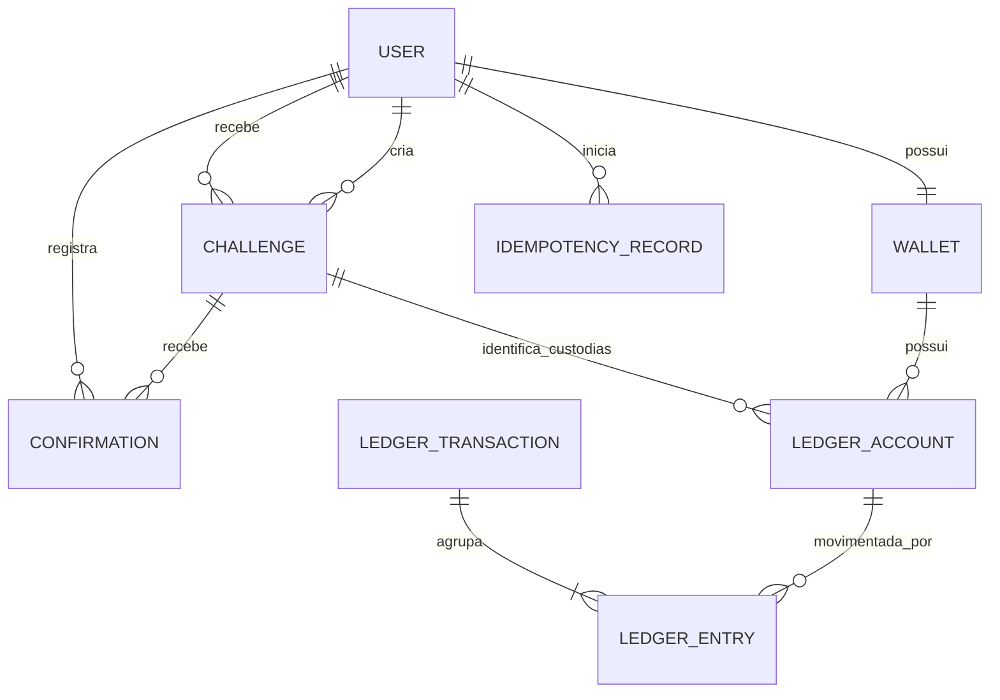

# PACTO — Modelo de domínio e decisões arquiteturais (PCT-002)

> **Ticket:** PCT-002 · **Sprint:** 01 (23–29/11/2026)  
> **Status:** APROVADO / DONE — modelagem documental; não implementado  
> **Aprovação formal:** 23/11/2026, pelo responsável pelo projeto, das cinco ADRs (`ADR-P002-01` a `ADR-P002-05`).  
> **Fonte funcional:** `docs/mvp.md` (PCT-001, aprovado em 23/11/2026).  
> **Objetivo:** definir entidades, relacionamentos, custódia, ledger, estados, fronteiras transacionais e decisões técnicas antes de codificar.

## 1. Premissas aprovadas no PCT-001

- Dois usuários de demonstração, A e B, cada um com 100 créditos inteiros iniciais; identidade apenas simulada.
- Desafio entre os dois, contribuição positiva e **igual por participante**, validada contra saldo disponível no aceite.
- A criação não reserva créditos; o aceite reserva as duas contribuições de forma atômica.
- Cada participante confirma uma vez e sem edição; acordo liquida uma vez; divergência deixa créditos bloqueados.
- Cancelamento apenas pelo criador enquanto `OPEN`; `DISPUTED`, `SETTLED` e `CANCELLED` são terminais no MVP.
- `Idempotency-Key` persistida, por usuário simulado e tipo de operação, com hash do payload e resposta final; concorrência não deve produzir novos efeitos, mesmo com chaves diferentes.

## 2. Modelo conceitual aprovado



A figura é conceitual: uma `LEDGER_ACCOUNT` do tipo `SYSTEM_ISSUANCE` não possui carteira; contas `CHALLENGE_ESCROW` possuem carteira, desafio e participante. A multiplicidade de `Challenge` para usuários é por papel (criador/destinatário), não significa que cada desafio tenha participantes arbitrários.

| Entidade | Campos conceituais importantes | Responsabilidade e cardinalidade |
|---|---|---|
| **User** | `id`, `display_name` | Duas identidades fixas; cada uma possui 1 `Wallet`. |
| **Wallet** | `id`, `user_id` único | Agregador lógico da carteira; **não** duplica saldo em campo próprio. |
| **LedgerAccount** | `id`, `type`, `wallet_id?`, `challenge_id?`, `balance` | `USER_AVAILABLE`: uma por wallet; `CHALLENGE_ESCROW`: uma por (challenge, participante); `SYSTEM_ISSUANCE`: conta de contrapartida sem wallet. O `balance` é saldo materializado reconciliável com o ledger. |
| **LedgerTransaction** | `id`, `kind`, `challenge_id?`, `created_at`, `business_operation_id` | Agrupa atomicamente lançamentos balanceados; `kind` pode ser `INITIAL_GRANT`, `RESERVE`, `SETTLE`. Operação de negócio identificável e única. |
| **LedgerEntry** | `id`, `transaction_id`, `account_id`, `delta`, `created_at` | Lançamento imutável; `delta` positivo credita e negativo debita. Soma por `LedgerTransaction` = 0. |
| **Challenge** | `id`, `creator_id`, `invitee_id`, `stake_per_participant`, `status`, `created_at`, `accepted_at?`, `settled_at?`, `version?` | Dois participantes diferentes; contribuição fixa depois de criado; controla transições e referências para custódia. |
| **Confirmation** | `id`, `challenge_id`, `participant_id`, `winner_id`, `created_at` | Um voto definitivo por (desafio, participante), com vencedor obrigatoriamente entre os dois participantes. |
| **IdempotencyRecord** | `id`, `actor_id`, `operation`, `key`, `payload_hash`, `state`, `http_status?`, `response_body?`, `created_at`, `completed_at?` | Unicidade por (actor, operation, key); persiste resposta final e coordena retries. Independente de existir efeito financeiro. |

### 2.1 Escolha recomendada: custódia separada por desafio **e participante**

Para o desafio D1 entre A e B, criar duas contas de custódia: `ESCROW(D1,A)` e `ESCROW(D1,B)`. As contas são internas, indisponíveis para novos desafios. Uma conta `USER_AVAILABLE` guarda o saldo utilizável de cada usuário. Isso facilita: auditar a origem de cada parcela, calcular `reserved` por usuário e conferir que cada participante reservou exatamente uma vez. É um pouco mais verboso do que uma única conta de custódia por desafio, mas evita deduções indiretas.

### 2.2 Sem saldo duplicado na Wallet

`Wallet` não contém `available_balance` nem `reserved_balance`. Saldo disponível = `balance` da conta `USER_AVAILABLE`. Saldo reservado = soma dos `balance` das contas `CHALLENGE_ESCROW` associadas à carteira. `LedgerAccount.balance` é projeção materializada atualizada **na mesma transação** dos `LedgerEntry`; a verdade auditável é a soma dos lançamentos dessa conta. Reconciliar os dois é uma invariante de teste e de manutenção.

## 3. Cenários contábeis (deltas positivos e negativos)

Cada linha abaixo representa **uma** `LedgerTransaction` contendo todos os lançamentos indicados. A soma dos deltas deve ser zero.

| Momento | Lançamentos de uma transação | Resultado |
|---|---|---|
| Carga A | `ISSUANCE -100`, `AVAILABLE(A) +100` | A com 100 disponíveis. |
| Carga B | `ISSUANCE -100`, `AVAILABLE(B) +100` | B com 100 disponíveis. |
| Aceite de D1 (20) | `AVAILABLE(A) -20`; `ESCROW(D1,A) +20`; `AVAILABLE(B) -20`; `ESCROW(D1,B) +20` | A=80, B=80 disponíveis, 20 reservados por participante. |
| A vence D1, ambos concordam | `ESCROW(D1,A) -20`; `ESCROW(D1,B) -20`; `AVAILABLE(A) +40` | A=120, B=80; custódia D1 zerada. |
| Divergência em D1 | Nenhum lançamento adicional | A=80, B=80 disponíveis; 40 em custódia. |
| Cancelar D1 ainda `OPEN` | Nenhum lançamento | Apenas estado `CANCELLED`; saldos inalterados. |

**Emissão inicial:** `SYSTEM_ISSUANCE` é conta especial de contrapartida, que pode apresentar saldo negativo; não é carteira de usuário. Todas as demais contas de créditos ficam não negativas. Esta exceção evita crédito fictício sem origem contábil.

## 4. Máquina de estados

```text
OPEN --[cancelamento pelo criador]--> CANCELLED
OPEN --[aceite pelo destinatário + 2 reservas atômicas]--> ACCEPTED
ACCEPTED --[1ª confirmação]--> AWAITING_RESULT
AWAITING_RESULT --[2ª confirmação igual]--> SETTLED + liquidação única
AWAITING_RESULT --[2ª confirmação diferente]--> DISPUTED + custódia mantida
```

| Comando | Pré-condições | Escritas atômicas | Pós-condição |
|---|---|---|---|
| Criar | Ator é um dos dois, destinatário é o outro, stake > 0 | `Challenge(OPEN)` e resultado idempotente | Sem lançamentos de créditos. |
| Cancelar | Ator = criador e estado `OPEN` | Estado `CANCELLED` e resultado idempotente | Nenhum crédito movido. |
| Aceitar | Ator = destinatário, estado `OPEN`, ambos têm saldo suficiente | Duas contas de custódia, 1 transação/4 lançamentos, projeções de saldo, estado `ACCEPTED`, resultado idempotente | Duas reservas, uma para cada participante, ou zero. |
| Primeira confirmação | Ator participa, ainda não confirmou, estado `ACCEPTED` | 1 `Confirmation`, estado `AWAITING_RESULT`, resultado idempotente | Sem lançar créditos. |
| Segunda confirmação igual | Ator participa, ainda não confirmou, estado `AWAITING_RESULT` | 1 `Confirmation`, 1 transação/3 lançamentos, saldos, estado `SETTLED`, resultado idempotente | Custódias zeradas, prêmio creditado uma única vez. |
| Segunda confirmação diferente | Mesmas condições da segunda confirmação | 1 `Confirmation`, estado `DISPUTED`, resultado idempotente | Custódias mantidas; sem liquidação. |

Qualquer transição fora da tabela deve ser rejeitada sem modificar saldos. Confirmação com mesma chave/payload pode retornar a resposta anterior; uma nova tentativa de confirmar com outra chave, após já confirmado, deve ser rejeitada como operação de negócio inválida.

## 5. Restrições e índices conceituais

- `Wallet.user_id` único.
- Uma conta `USER_AVAILABLE` por carteira.
- Uma conta `CHALLENGE_ESCROW` por par `(challenge_id, wallet_id)`; nenhuma com saldo negativo.
- `Challenge.creator_id != Challenge.invitee_id` e `stake_per_participant > 0`.
- `Confirmation(challenge_id, participant_id)` único; validação de participante e vencedor pertencentes ao desafio é regra de domínio na mesma transação (pode ser reforçada por esquema/constraints adicionais).
- `IdempotencyRecord(actor_id, operation, key)` único; comparar hash para detectar payload diferente.
- `LedgerTransaction(business_operation_id)` único; operações financeiras por desafio e tipo (`RESERVE` e `SETTLE`) não se repetem.
- `LedgerEntry.delta != 0`, lançamentos imutáveis e relacionamentos com FK.
- `LedgerAccount.balance >= 0` para contas de usuário e custódia; `SYSTEM_ISSUANCE` é exceção explícita.
- Cada transação financeira precisa ter soma dos deltas = 0 e correspondência exata entre variação do saldo materializado e ledger. Essa garantia será verificada pela orquestração transacional/testes; reforço por trigger/constraint diferida é evolução opcional.

## 6. Concorrência, atomicidade e idempotência

**Recomendação:** PostgreSQL como coordenador único (sem Redis/filas), transações Spring e locks pessimistas nas linhas pertinentes. Para reduzir deadlocks, adquirir locks numa ordem previsível: primeiro registro de idempotência do comando, depois desafio (quando houver), depois contas contábeis em ordem estável de ID. Leitura simples não adquire esses locks.

1. **Dois aceites com chaves diferentes:** um obtém o lock de `Challenge`, efetiva reservas e muda para `ACCEPTED`. O outro, ao prosseguir, encontra estado incompatível, sem lançar créditos.
2. **Dois desafios distintos concorrendo pelos mesmos saldos:** ambos travam contas disponíveis em ordem consistente; um pode consumir o saldo e o outro falha se não houver saldo suficiente.
3. **Confirmações simultâneas:** ambas serializadas pelo lock do desafio; unicidade `(challenge, participant)` impede confirmação dupla. A última confirmação válida calcula uma única transição terminal.
4. **Mesmo comando com mesma chave ao mesmo tempo:** unicidade e serialização no registro de idempotência evitam execução paralela. Se o primeiro já concluiu, o segundo recebe a resposta persistida; se ainda está em execução, pode aguardar ou receber estado transitório (contrato HTTP a definir depois).
5. **Crash/rollback:** resposta de sucesso e efeito de negócio devem ser confirmados no mesmo commit. Falha antes do commit não pode registrar sucesso sem movimentação. Falha após commit e antes da resposta HTTP é recuperada pelo retry da mesma chave.

**Nota de implementação futura:** criar ou bloquear um `IdempotencyRecord` concorrente com `INSERT` único precisa ser desenhado com cuidado para não iniciar uma transação de negócio que falha em violação de unicidade e depois tenta reutilizar a mesma transação abortada. O desenho final de orquestração será validado no PCT-015 e nos testes. Esta etapa ainda não escolhe detalhes de código.

## 7. Módulos do monólito

| Módulo | Dono das regras | Interface conceitual com os demais |
|---|---|---|
| `challenge` | Criação, aceite, estados, confirmações e resultado | Solicita movimentações atômicas a `wallet`; publica resultado do comando ao controle de idempotência. |
| `wallet` | Contas, saldos, custódias, ledger e invariantes financeiros | Opera reservas/liquidações dentro da transação do comando, sem aceitar débitos desconectados do ledger. |
| `idempotency` | Normalização/hash, chave única, replay de resposta, retries | Envolve comandos mutáveis; resultado persistido na mesma unidade transacional do efeito. |
| `demo` (suporte) | Identidades fixas e carga inicial | Não realiza autenticação; só fornece usuários predefinidos ao MVP. |

O `challenge` coordena a transação de aceite/resultado; os módulos compartilham a mesma base PostgreSQL e o mesmo commit — **não** são microserviços.

## 8. Trade-offs e decisões arquiteturais aprovadas

| ID | Alternativas | Recomendação | Consequência |
|---|---|---|---|
| **ADR-P002-01 — Custódia** | 1 conta por desafio **vs.** 1 por desafio e participante | **1 por desafio e participante** | Mais contas; rastreabilidade de quem reservou e consulta de saldo reservado mais simples. |
| **ADR-P002-02 — Saldo** | Somar todo o ledger em cada leitura **vs.** saldo materializado | **Saldo materializado em `LedgerAccount`**, reconciliável | Leitura e lock eficientes; exige atualizar saldo e lançamentos no mesmo commit. |
| **ADR-P002-03 — Ledger** | Histórico mutável de operações **vs.** lançamentos imutáveis balanceados | **Lançamentos imutáveis e soma zero** | Melhor auditoria e prova de integridade; modelo ligeiramente maior. |
| **ADR-P002-04 — Concorrência** | Lock otimista com versão e retry **vs.** lock pessimista de linhas | **Lock pessimista com ordem estável** | Mais fácil demonstrar serialização no MVP; risco de bloqueio/deadlock deve ser testado. |
| **ADR-P002-05 — Resultado idempotente** | Guardar apenas chave **vs.** chave+hash+status+resposta | **Chave+hash+resultado atômico** | Replays fiéis após reinício; tratamento de operações em andamento precisa de contrato. |

**Status de todas as ADRs:** `APROVADO` em 23/11/2026 por confirmação formal do responsável pelo projeto. As seis decisões de negócio do PCT-001 permanecem `APROVADAS` e não foram reabertas. A aprovação estabelece a linha de base do desenho, não comprova ainda o comportamento de código ou migrations.

## 9. Definition of Done — PCT-002

- [x] Entidades, campos conceituais e cardinalidades documentados em tabela e diagrama ER.
- [x] Custódia por desafio e participante definida; reserva, liquidação, divergência e carga inicial descritas com lançamentos que somam zero.
- [x] Estados, transições e fronteiras de escrita atômica mapeados, inclusive confirmação e cancelamento.
- [x] Constraints, unicidades, reconciliação de saldo e abordagem de controle concorrente registradas.
- [x] Cinco decisões arquiteturais (`ADR-P002-01` a `ADR-P002-05`) revisadas e aprovadas formalmente.
- [x] Modelo conceitual aprovado como linha de base para PCT-004 (migrations) e demais tickets de implementação.

### Evidências da revisão

| Critério | Evidência documental |
|---|---|
| Entidades e cardinalidades | Seção 2: diagrama ER e tabela das oito entidades. |
| Custódia e ledger | Seções 2.1–3: contas por participante; deltas balanceados para carga, reserva e liquidação. |
| Máquina de estados | Seção 4: transições e pré/pós-condições de cada comando. |
| Concorrência e idempotência | Seções 5–6: unicidade, locks ordenados, transações e tratamento de retries. |
| Aprovação arquitetural | Seção 8: ADR-P002-01 a ADR-P002-05 formalmente aprovadas em 23/11/2026. |

**Status final: PCT-002 — DONE (modelagem aprovada em 23/11/2026).** Nenhum código, migration, endpoint ou teste executável foi criado neste ticket. A validação empírica das garantias de concorrência, idempotência e integridade ocorrerá nos tickets de implementação e teste.

## 10. Próximo ticket — PCT-003 (TODO, sem implementação nesta etapa)

**Título:** Estruturar repositório e configurar Java/Spring Boot + React/Vite.  
**Prioridade:** P0 · **Estimativa inicial do roadmap:** 65 minutos.

**Escopo planejado:** monorepositório com `backend/` e `frontend/`, monólito modular Spring Boot, React + Vite + TypeScript, configuração mínima de inicialização, `.gitignore` e scripts/comandos documentados para execução local. Preparar o repositório e a licença (a definir pelo responsável) sem adiantar migrations, ledger, entidades persistidas ou regras financeiras.

**Critérios de aceite planejados:** backend inicializa e apresenta uma verificação básica de saúde; frontend Vite inicializa e abre no navegador; ambos podem ser executados usando instruções reproduzíveis no README; estrutura de diretórios e arquivos de configuração fica versionável sem credenciais. O banco e as migrations são responsabilidade do PCT-004.

